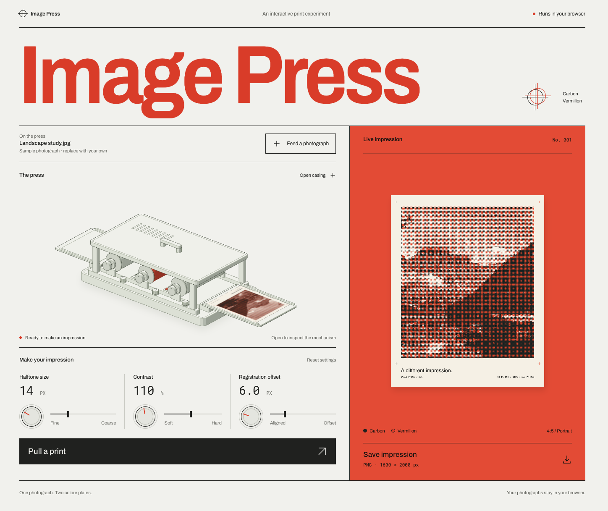

# Image Press

An interactive two-ink photo press built with [Anatomy](https://github.com/wheresryan22/anatomy), SVG, and Canvas. Upload a photograph, adjust the ink, and pull an impression. Open the casing to inspect the rollers and colour plates, then save the result as a PNG.



The interface follows Swiss print design, with oversized red type, a ruled grid, physical dials, and an upright proof on a vermilion field. The machine sheet and preview use the same rendered image.

## Run locally

Use Node.js 22.20 or later. No npm packages or API keys are required.

```sh
git clone https://github.com/notlestat/image-press.git
cd image-press
npm run build
npm run dev
```

Open [localhost:4173](http://localhost:4173). The server listens only on the local machine. To use another port, run `PORT=4174 npm run dev`.

## Make an impression

1. Select **Feed a photograph**, or drop one photograph onto the page.
2. Adjust **Halftone size**, **Contrast**, and **Registration offset**. Drag a dial vertically, or focus a slider and use the arrow keys.
3. Select **Open casing** to inspect the mechanism.
4. Select **Pull a print** to feed a sheet through the press.
5. Select **Save impression** to download the current proof as a 1600 × 2000 PNG.

A sample photograph is loaded on startup. JPEG, PNG, WebP, and AVIF uploads are supported, up to 30 MB and 64 megapixels. Photographs stay in browser memory and use a centred portrait crop. Resetting the controls keeps the loaded photograph.

Halftone size sets the dot spacing. Contrast changes tonal separation. Registration shifts the vermilion plate relative to carbon. These are experimental graphic effects, not a calibrated printing simulation.

## Check changes

```sh
npm test
npm run audit
```

The tests cover cropping, luminance, transparency, contrast, and halftone radius. The Anatomy audit checks geometry and depth order throughout the casing movement.

Browser checks cover uploads, keyboard controls, dial dragging, error recovery, printing, reduced motion, responsive layout, and matching preview and export bytes. Chromium is verified. Safari and Firefox have not been verified.

## Project structure

- [src/app.mjs](src/app.mjs) connects the controls, uploads, machine motion, and export.
- [src/print-model.mjs](src/print-model.mjs) renders the two-ink halftone image.
- [scripts/build.mjs](scripts/build.mjs) generates the machine drawing and geometry records.
- [docs/image-press.md](docs/image-press.md) describes the mechanism, image model, and validation.
- [DESIGN.md](DESIGN.md) records the layout, typography, colour, and interaction rules.

## Credits

The drawing kit is vendored from [Anatomy](https://github.com/wheresryan22/anatomy) under its [MIT license](vendor/anatomy/LICENSE).

The [sample landscape photograph](https://images.unsplash.com/photo-1470770841072-f978cf4d019e) is supplied by Unsplash. User uploads replace it.

[Archivo](https://github.com/google/fonts/tree/main/ofl/archivo) and [Roboto Mono](https://github.com/google/fonts/tree/main/ofl/robotomono) are served locally under the SIL Open Font License. Their license files are retained in [assets/fonts](assets/fonts/).
